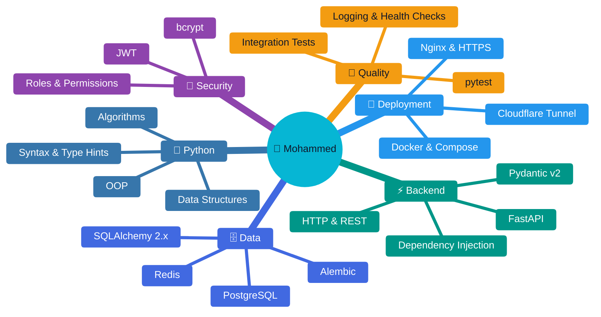
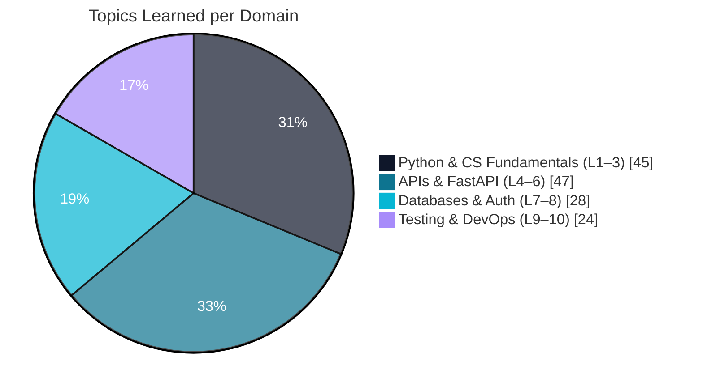
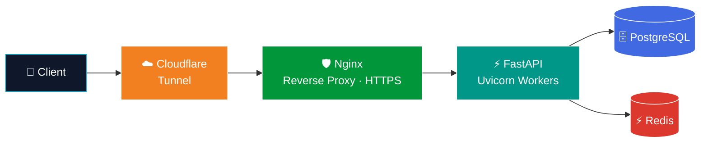
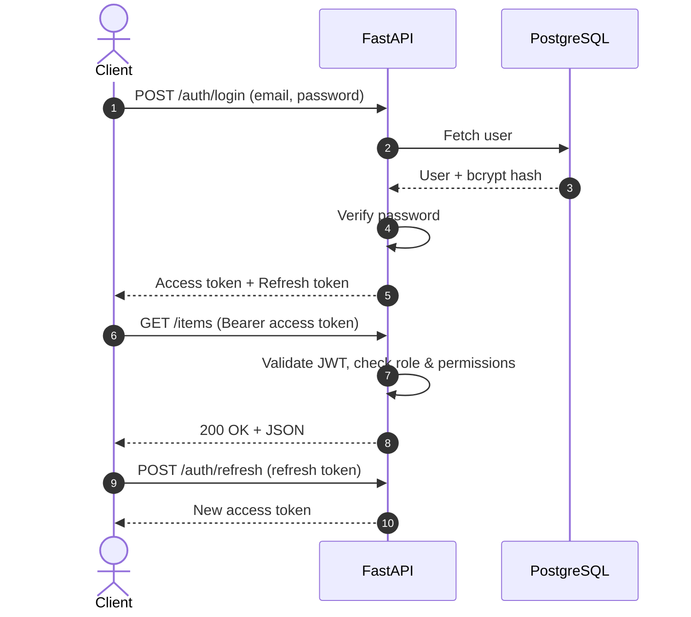

<div align="center">
  

  <h1>Hi, I'm Mohammed 👋</h1>

  <a href="https://github.com/shngal">
    
  </a>

  <br/><br/>

  
  
  
  
  
  
  
</div>

<br/>

## 👨‍💻 About Me

```python
class Developer:
    name    = "Mohammed"
    role    = "Software Engineer → Senior AI Software Engineer"
    stack   = ["Python", "FastAPI", "PostgreSQL", "SQLAlchemy", "Docker"]
    mindset = "Fundamentals first, production quality always"

    def current_goal(self):
        return "Master backend engineering, then build intelligent AI systems"

    def __repr__(self):
        return "Learning in public 🚀"
```

- 🎯 **Goal:** become a **Senior AI Software Engineer**
- 🧱 **Foundation:** Python, OOP, data structures & algorithms, HTTP/REST
- ⚙️ **Backend:** async FastAPI services, PostgreSQL, JWT auth, migrations, tests
- 📦 **Shipping:** containerised deployments with Docker, Nginx, HTTPS and Cloudflare Tunnel
- 🔭 **Next up:** machine learning, deep learning, LLM applications and MLOps

<br/>

## 🛠️ Tech Stack

<div align="center">
  
</div>

<br/>

| | Area | Technologies |
|:-:|:--|:--|
| 🐍 | **Language** |     |
| ⚡ | **Backend** |     |
| 🗄️ | **Database** |     |
| 🔐 | **Security** |     |
| 🧪 | **Testing** |    |
| 🚀 | **DevOps** |     |

<br/>

## 🧠 Skill Map



<br/>

## 🗺️ Learning Roadmap

```mermaid
flowchart LR
    A["🐍 Python<br/>L1 · L2"] --> B["🧠 DSA<br/>L3"]
    B --> C["🌐 HTTP & REST<br/>L4"]
    C --> D["⚡ FastAPI<br/>L5 · L6"]
    D --> E["🗄️ PostgreSQL<br/>L7 · L8"]
    E --> F["🧪 Testing<br/>L9"]
    F --> G["🚀 Docker & Deploy<br/>L10"]
    G --> H["🤖 AI / ML Engineering"]
    H --> I["🏆 Senior AI Software Engineer"]

    style A fill:#0F172A,stroke:#06B6D4,color:#fff
    style B fill:#134E4A,stroke:#06B6D4,color:#fff
    style C fill:#155E75,stroke:#06B6D4,color:#fff
    style D fill:#0E7490,stroke:#06B6D4,color:#fff
    style E fill:#0891B2,stroke:#fff,color:#fff
    style F fill:#06B6D4,stroke:#fff,color:#0F172A
    style G fill:#22D3EE,stroke:#fff,color:#0F172A
    style H fill:#A78BFA,stroke:#fff,color:#0F172A
    style I fill:#FACC15,stroke:#fff,color:#0F172A
```



### 📊 Progress by Level

| Level | Topic | Progress | Status |
|:-:|:--|:--|:-:|
| **1** | Python Fundamentals |  | 🟢 |
| **2** | Object-Oriented Python |  | 🟢 |
| **3** | Data Structures & Algorithms |  | 🟢 |
| **4** | HTTP & REST |  | 🟢 |
| **5** | FastAPI Fundamentals |  | 🟢 |
| **6** | Pydantic, DI & Project Structure |  | 🟡 |
| **7** | PostgreSQL + SQLAlchemy |  | 🟡 |
| **8** | Alembic + Authentication |  | 🟡 |
| **9** | Testing + Production Basics |  | 🟡 |
| **10** | Docker + Deployment |  | 🔴 |

<br/>

## 📈 Graphs

### Where My Knowledge Lives



<br/>

## 🏗️ How I Build Backends

### Production Architecture



### Authentication Flow (JWT)



### Project Structure

```text
app/
├── main.py              # FastAPI() app + router registration
├── core/
│   ├── config.py        # settings from environment variables
│   └── security.py      # bcrypt hashing + JWT helpers
├── api/
│   ├── deps.py          # Depends(): DB session, current user, roles
│   └── routers/         # APIRouter modules per resource
├── schemas/             # Pydantic v2 request / response models
├── models/              # SQLAlchemy 2.x ORM models
├── services/            # business logic, kept out of the routes
├── db/                  # async engine + AsyncSession
├── alembic/             # database migrations
└── tests/               # pytest + TestClient + dependency overrides
```

<br/>

## 🧭 Engineering Principles

| | Principle | In practice |
|:-:|:--|:--|
| 🧱 | **Fundamentals first** | Data structures, OOP and HTTP before frameworks |
| 🧩 | **Clean architecture** | Routers, schemas, models and services each have one job |
| ✅ | **Test what matters** | pytest, integration tests and dependency overrides |
| 🔐 | **Secure by default** | Hashed passwords, short-lived tokens, role-based access |
| 📦 | **Reproducible** | Docker, Compose and environment-based configuration |
| 📖 | **Documented APIs** | OpenAPI and Swagger UI generated from typed code |

<br/>

## 🎯 Current Focus

- 🔄 Hardening **testing and production basics** (Level 9)
- 🐳 Deepening **Docker and deployment** (Level 10)
- 🤖 Preparing for **AI engineering**: ML, deep learning and LLM-powered applications

<br/>

## 📚 What I've Learned (Detailed)

<details>
<summary><b>🟢 Level 1 — Python Fundamentals</b></summary>
<br/>

`Python syntax` · `Variables` · `Control flow` · `Functions` · `Lists` · `Tuples` · `Sets` · `Dictionaries` · `Strings` · `Comprehensions` · `Exceptions` · `File I/O` · `Modules` · `Packages` · `Type hints` · `Virtual environments` · `Dependency management`
</details>

<details>
<summary><b>🟢 Level 2 — Object-Oriented Python</b></summary>
<br/>

`Classes` · `Objects` · `__init__` · `Instance attributes` · `Class attributes` · `Methods` · `Inheritance` · `Polymorphism` · `Encapsulation` · `Composition` · `Properties` · `Magic methods` · `Abstract base classes`
</details>

<details>
<summary><b>🟢 Level 3 — Data Structures & Algorithms</b></summary>
<br/>

`Big-O` · `Lists/arrays` · `Stacks` · `Queues` · `Hash tables` · `Sets` · `Linked lists` · `Trees` · `Heaps` · `Graphs` · `Recursion` · `Searching` · `Sorting` · `BFS` · `DFS`
</details>

<details>
<summary><b>🟢 Level 4 — HTTP & REST</b></summary>
<br/>

`HTTP` · `Requests` · `Responses` · `Methods` · `URLs` · `Headers` · `Body` · `JSON` · `Status codes` · `Cookies` · `CORS` · `REST resources` · `CRUD API design` · `Pagination` · `Filtering` · `Sorting`
</details>

<details>
<summary><b>🟢 Level 5 — FastAPI Fundamentals</b></summary>
<br/>

`FastAPI()` · `Uvicorn` · `Routes` · `Path operations` · `GET` · `POST` · `PUT` · `PATCH` · `DELETE` · `Path parameters` · `Query parameters` · `Request body` · `Response models` · `HTTPException` · `OpenAPI` · `Swagger UI`
</details>

<details>
<summary><b>🟢🟡 Level 6 — Pydantic, Dependency Injection & Project Structure</b></summary>
<br/>

`BaseModel` · `Field` · `Validation` · `Nested models` · `Enums` · `Serialization` · `Pydantic v2` · `Depends()` · `yield dependencies` · `APIRouter` · `Schemas` · `Models` · `Services` · `Dependencies` · `Configuration`
</details>

<details>
<summary><b>🟡 Level 7 — PostgreSQL + SQLAlchemy</b></summary>
<br/>

`PostgreSQL` · `SQLAlchemy 2.x` · `Async engine` · `AsyncSession` · `ORM models` · `Relationships` · `CRUD` · `SELECT` · `WHERE` · `JOIN` · `ORDER BY` · `LIMIT` · `OFFSET` · `Transactions`
</details>

<details>
<summary><b>🟡 Level 8 — Alembic + Authentication</b></summary>
<br/>

`Database migrations` · `revision` · `autogenerate` · `upgrade` · `downgrade` · `Password hashing` · `bcrypt` · `JWT` · `Access tokens` · `Refresh tokens` · `Authentication` · `Authorization` · `Roles` · `Permissions`
</details>

<details>
<summary><b>🟡 Level 9 — Testing + Production Basics</b></summary>
<br/>

`pytest` · `TestClient` · `Async tests` · `API integration tests` · `Database testing` · `Dependency overrides` · `Authentication testing` · `Middleware` · `Error handling` · `Environment variables` · `Logging` · `Health checks` · `Basic security`
</details>

<details>
<summary><b>🔴 Level 10 — Docker + Deployment</b></summary>
<br/>

`Docker` · `Docker Compose` · `PostgreSQL containers` · `Redis basics` · `Reverse proxy` · `Nginx` · `HTTPS` · `Workers` · `Deployment` · `Cloudflare` · `Cloudflare Tunnel`
</details>

<br/>

## 🤖 Next Stop: AI Engineering

<div align="center">
  

  <br/><br/>

  
  
  
  
</div>



<br/>

```mermaid
flowchart LR
    A["🐍 Python + FastAPI<br/>(done)"] --> B["📊 NumPy · Pandas<br/>Data handling"]
    B --> C["🤖 Machine Learning<br/>scikit-learn"]
    C --> D["🧬 Deep Learning<br/>PyTorch"]
    D --> E["💬 LLM Applications<br/>APIs · RAG · agents"]
    E --> F["⚙️ MLOps<br/>Docker · CI/CD · monitoring"]

    style A fill:#0F172A,stroke:#06B6D4,color:#fff
    style B fill:#155E75,stroke:#06B6D4,color:#fff
    style C fill:#0E7490,stroke:#06B6D4,color:#fff
    style D fill:#A78BFA,stroke:#fff,color:#0F172A
    style E fill:#E879F9,stroke:#fff,color:#0F172A
    style F fill:#FACC15,stroke:#fff,color:#0F172A
```

## 🚀 Featured Projects

<!-- Replace the placeholders below with your real repositories -->
| Project | Description | Stack |
|:--|:--|:--|
| [**DeepCount**](https://github.com/shngal/REPO_NAME_1) | Industrial AI Backend |    |
| [**CellScope 2**](https://github.com/shngal/REPO_NAME_2) | Medical Computer Vision Project |  |

<br/>

## 🤝 Let's Connect

<div align="center">
  <a href="https://github.com/shngal"></a>
  <a href="https://www.linkedin.com/in/YOUR_LINKEDIN/"></a>
  <a href="mailto:YOUR_EMAIL@example.com"></a>
  <a href="https://t.me/YOUR_TELEGRAM"></a>

  <br/><br/>

  <i>"First, solve the problem. Then, write the code."</i>

  <br/><br/>

  
</div>
